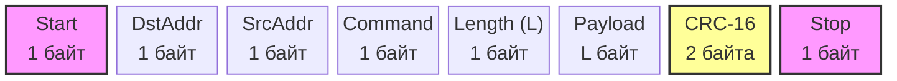

# Спецификация протокола ESP32-RS485

## 1. Общие положения
Протокол предназначен для организации обмена данными между устройствами на базе микроконтроллеров ESP32 по физическому интерфейсу RS-485 (полудуплекс).
Архитектура сети: строгая модель «Ведущий – Ведомый» (Master-Slave).

## 2. Адресация узлов
Применяется двухэтапная схема адресации:
1. **Идентификация**: Каждый узел имеет уникальный MAC-адрес (6 байт).
2. **Короткий адрес (Short ID)**: Мастер при инициализации назначает Ведомым 1-байтовые адреса (`1..254`).
   * `0x00` — Broadcast (широковещательный запрос, Ведомые не отвечают, если не указано иное).
   * `0xFF` — Зарезервировано (Адрес Мастера).
   * `0xFE` — Адрес для нераспределенных (новых) узлов.

## 3. Формат кадра
Все данные передаются в бинарном виде (Big-Endian для многобайтовых полей).



| Смещение | Размер (байт) | Поле | Описание |
| :--- | :--- | :--- | :--- |
| 0 | 1 | **Start** | Синхробайт начала кадра — `0xAA` |
| 1 | 1 | **DstAddr** | Адрес получателя (0x00 - Broadcast, 0xFE - Discovery, 1-254 - узлы) |
| 2 | 1 | **SrcAddr** | Адрес отправителя (Short ID, 0xFF для Мастера) |
| 3 | 1 | **Command** | Код команды |
| 4 | 1 | **Length (L)** | Длина поля Payload (0..64) |
| 5 | L | **Payload** | Полезные данные |
| 5+L | 2 | **CRC-16** | Контрольная сумма (CRC-16/Modbus) |
| 7+L | 1 | **Stop** | Синхробайт конца кадра — `0x55` |

### 3.1. Алгоритм расчета CRC-16/Modbus
Полином: `0xA001` (реверсивный `0x8005`), Начальное значение: `0xFFFF`. 
Расчет производится для всех байт кадра, начиная с поля `DstAddr` и заканчивая последним байтом `Payload`. Байты `Start` и `Stop`, а также сами байты CRC в расчет не включаются.

**Пример функции на C (Arduino):**
```c
uint16_t calculateCRC(const uint8_t *data, uint8_t length) {
    uint16_t crc = 0xFFFF;
    for (uint8_t i = 0; i < length; i++) {
        crc ^= (uint16_t)data[i];
        for (uint8_t j = 0; j < 8; j++) {
            if (crc & 0x0001) {
                crc >>= 1;
                crc ^= 0xA001;
            } else {
                crc >>= 1;
            }
        }
    }
    return crc;
}
```

## 4. Спецификация команд (Payload)

### 4.1. PING (Cmd: `0x01`)
Проверка связи. Payload отсутствует (L=0).
* **Запрос**: Master -> Slave.
* **Ответ**: Slave -> Master. Payload: `[0x00]` (1 байт, успех).

### 4.2. GET_STATUS (Cmd: `0x02`)
Запрос телеметрии.
* **Запрос**: Master -> Slave. Payload отсутствует (L=0).
* **Ответ**: Slave -> Master. Payload: 
  * Байт 0: Версия прошивки (major)
  * Байт 1: Версия прошивки (minor)
  * Байт 2-3: Напряжение питания (uint16_t, милливольты)
  * Байт 4: Состояние выходов (битовая маска, 0-7 выходы)

### 4.3. SET_OUTPUT (Cmd: `0x03`)
Управление исполнительными устройствами.
* **Запрос**: Master -> Slave. Payload:
  * Байт 0: Номер выхода (0..7)
  * Байт 1: Состояние (0 - выключено, 1 - включено)
* **Ответ**: Slave -> Master. Payload: `[0x00]` (успех) или `[0x01]` (ошибка: неверный номер выхода).

### 4.4. ASSIGN_ID (Cmd: `0x10`)
Назначение короткого адреса (Discovery). Payload: 7 байт.
* **Запрос (Broadcast)**: Master -> All. Payload:
  * Байт 0: Новый Short ID (1..254)
  * Байт 1-6: Целевой MAC-адрес узла.
* **Ответ**: Узел с совпавшим MAC отвечает `[0x00]` (успех). Остальные молчат.

### 4.5. Общие коды ошибок (NACK)
Если Слейв получил валидный по CRC кадр, но не может его выполнить, он отвечает командой `Cmd | 0x80` (например, `0x83` для SET_OUTPUT) с Payload из 1 байта — кодом ошибки:
* `0x01` — Неизвестная команда
* `0x02` — Неверная длина Payload
* `0x03` — Ошибка выполнения (например, нет такого пина)

## 5. Тайминги
* **Turnaround Delay**: `T_delay = ShortID * 2` мс (Ведомый выжидает перед ответом).
* **Тайм-аут Мастера**: 50 мс на ответ.
* **Межкадровый интервал**: 3.5 символа (для 115200 это ~0.3 мс, для 9600 ~4 мс).