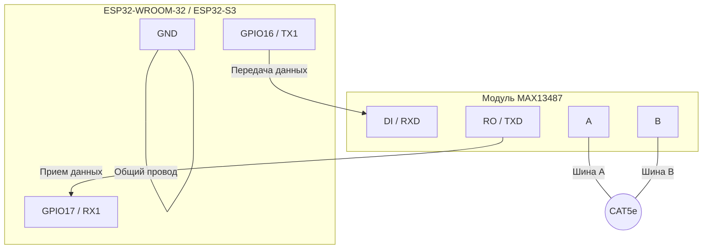

# Физический уровень и аппаратная реализация

## 1. Топология и кабель

- **Топология**: Магистральная шина (Daisy-chain). Звездообразная топология не допускается.
- **Кабель**: Витая пара CAT5e. Рекомендуется использовать одну пару для линий A/B и задействовать вторую свободную пару для линии GND (общий провод) для выравнивания потенциалов.
- **Терминаторы**: На обоих концах шины (только на крайних узлах) установлены резисторы номиналом 120 Ом для согласования волнового сопротивления.

## 2. Модуль трансивера (MAX13487)

Используются готовые модули на базе MAX13487 (или аналогов с автонаправлением).

- **Управление направлением (DE/RE)**: Не требуется. MAX13487 имеет встроенную схему AutoDirection, которая автоматически переключает трансивер в режим передачи при появлении данных на линии TX и возвращает в режим приема по окончании передачи.
- **Fail-safe biasing**: Модули уже содержат встроенную обвязку для подтяжки линий, что гарантирует логическую «1» на шине при отсутствии активных передатчиков.
- **Питание**: 5В (модули обычно запитываются от 5В, но логические уровни на стороне MCU совместимы с 3.3В ESP32). Если модуль имеет только 5В логику, необходимо использовать уровень-конвертер (Level Shifter) для линий TX/RX.

## 3. Подключение к ESP32

Для связи с модулем MAX13487 используется аппаратный UART (UART1 или UART2). UART0 (USB) остается для отладки и прошивки.

| ESP32 (MCU)    | MAX13487 (Модуль) | Примечание                                    |
| :------------- | :---------------- | :-------------------------------------------- |
| `GPIO16` (TX1) | RXD (или DI)      | Линия передачи данных (от MCU к трансиверу)   |
| `GPIO17` (RX1) | TXD (или RO)      | Линия приема данных (от трансивера к MCU)     |
| `3.3V` / `5V`  | VCC               | Питание модуля (согласно спецификации модуля) |
| `GND`          | GND               | Общий провод                                  |

## 4. Скоростные ограничения

Использование кабеля CAT5e и трансивера MAX13487 позволяет эксплуатировать сеть в следующих режимах:

- **115200 baud**: Уверенная передача на длинах до 100 метров.
- **9600 baud**: Передача на длинах свыше 100 метров (до 1000-1200 метров при качественном кабеле).
- **Не рекомендуется**: Превышать 100 метров на скорости 115200 baud без использования репитеров/повторителей интерфейса RS-485.
