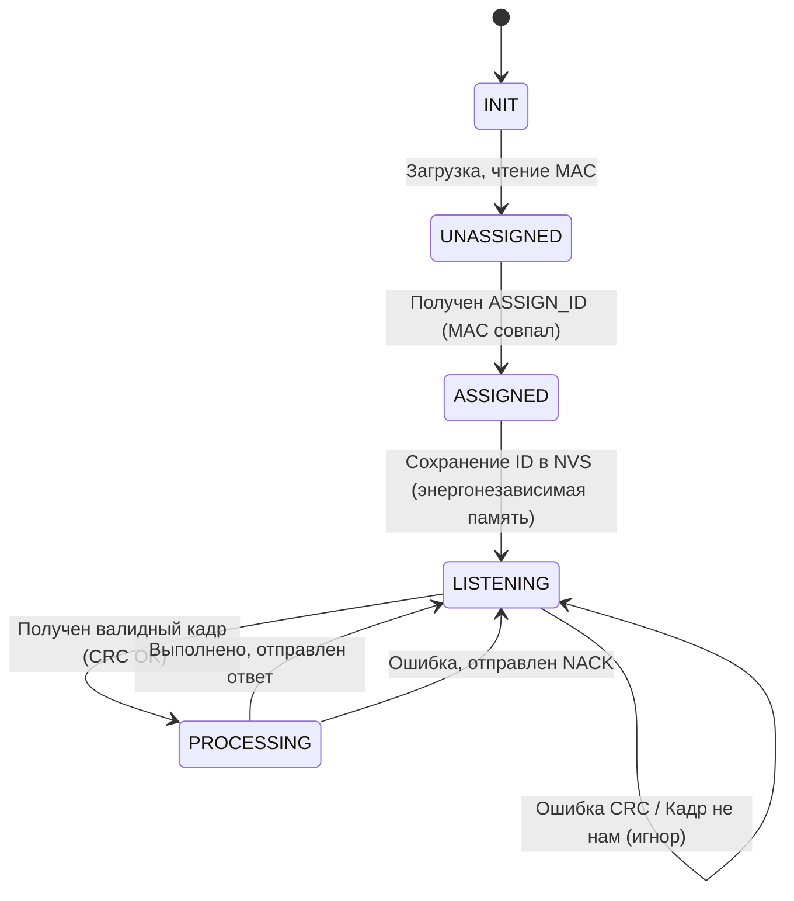
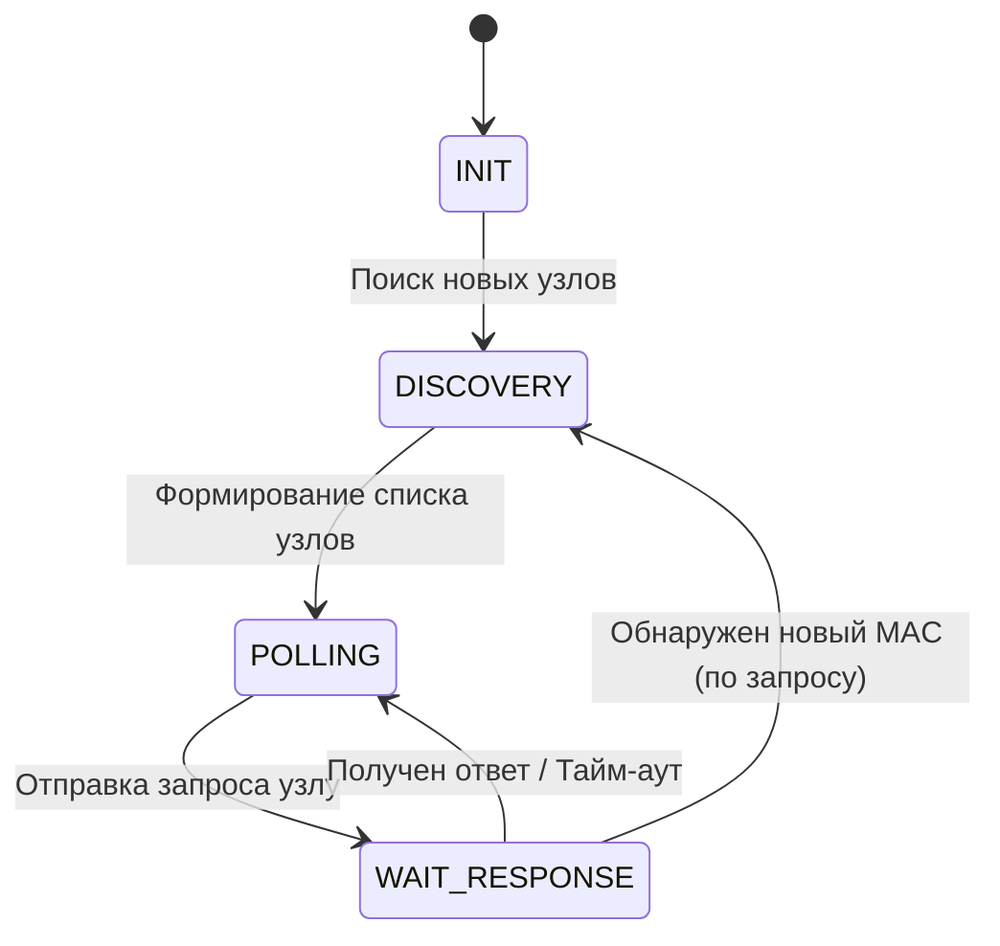
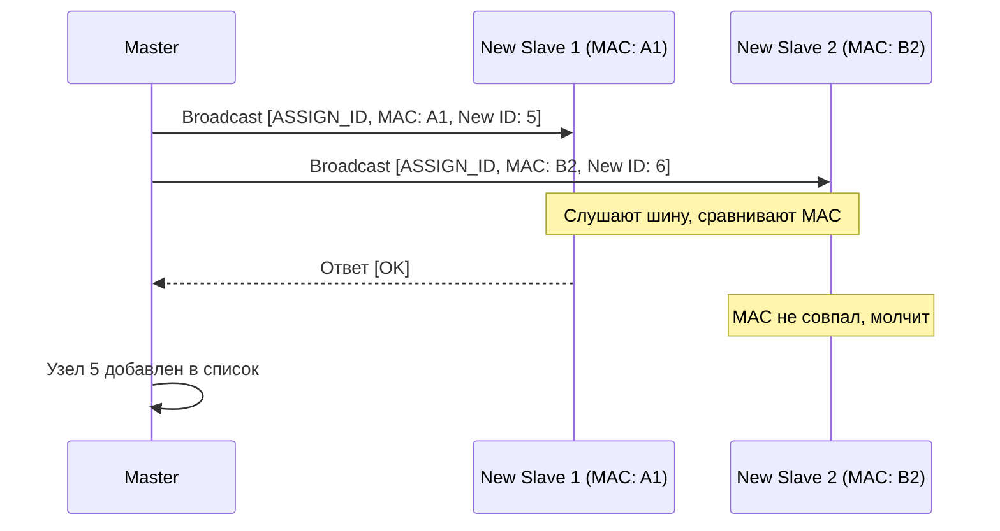

# Поведение узлов и обработка ошибок

## 1. Конечный автомат Ведомого узла (Slave FSM)

Ведомый узел работает по неблокирующему принципу (используя `millis()`). Основные состояния:

- **INIT**: Инициализация UART, загрузка сохраненного Short ID из NVS (Preferences в Arduino).
- **UNASSIGNED**: Если ID в памяти нет (`0xFE`), узел слушает шину. Отвечает только на команду `ASSIGN_ID` (если MAC совпал).
- **ASSIGNED**: Узел имеет валидный ID (1..254) и готов к работе.
- **LISTENING**: Узел читает байты из UART. Если поймал `0xAA`, начинает собирать кадр.
- **PROCESSING**: Проверка CRC, длины и адресата. Если адрес совпал (или Broadcast, где нужен ответ), выполняется действие и формируется ответ.

## 2. Конечный автомат Мастера (Master FSM)

- **DISCOVERY**: Мастер циклически отправляет Broadcast-запросы для поиска нераспределенных узлов. Или ждет команды от Python-клиента для запуска поиска.
- **POLLING**: Мастер опрашивает узлы по расписанию (например, раз в секунду каждый).
- **WAIT_RESPONSE**: Ожидание ответа (тайм-аут 50 мс). Если ответа нет — узел помечается как `OFFLINE`, но Мастер продолжает слать ему PING с меньшей частотой (например, раз в 10 секунд), чтобы восстановить связь.

## 3. Процедура Discovery (Назначение ID)

**Алгоритм действий Мастера:**

1. Мастер не знает, какие узлы на шине. Он отправляет Broadcast (`DstAddr=0xFE`) с командой `ASSIGN_ID`, указывая целевой MAC-адрес и новый Short ID.
2. Чтобы избежать коллизий, Мастер делает паузу между отправками запросов на разные MAC-адреса.
3. _Альтернативный вариант (если MAC-адреса узлов неизвестны)_:
   Мастер отправляет `PING_DISCOVERY` (Broadcast). Все нераспределенные узлы ждут случайное время `random(10, 100)` мс и, если шина свободна, отправляют свой MAC. Мастер ловит один MAC, назначает ему ID, затем повторяет процесс. (Этот метод сложнее в реализации на Arduino, поэтому рекомендуется первый вариант — жесткое назначение MAC).

## 4. Обработка ошибок на уровне приема

1. **Ошибка CRC**: Кадр молча отбрасывается. Счетчик ошибок узла инкрементируется (для диагностики).
2. **Неверная длина (Length)**: Если `Length` больше 64, кадр отбрасывается. Если `Length` меньше реально принятого (до `0x55`), лишние байты игнорируются.
3. **Неизвестная команда**: Отправляется NACK (`Cmd | 0x80` с кодом ошибки `0x01`), если запрос был адресован лично узлу. На Broadcast — молчание.
4. **Залипание шины**: Если UART приемник не получает данные в течение 100 мс, буфер очищается, состояние сбрасывается в `LISTENING`.

## 5. Защита от "зависаний" (Watchdog)

В ESP32 (Arduino) обязательно использовать `esp_task_wdt_reset()` внутри основного цикла `loop()`, чтобы устройство перезагружалось, если код завис (например, из-за аппаратного сбоя UART). Тайм-аут Watchdog рекомендуется ставить на 5-10 секунд.
